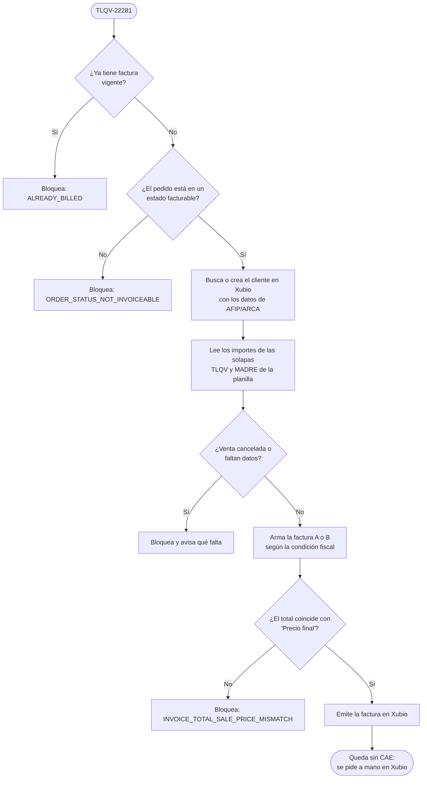

# Invoice API

Microservicio interno de **Tienda Lo Quiero Acá** que factura las ventas (TLQV) en Xubio.

Recibe un código de venta (`TLQV-22281`), verifica que se pueda facturar, encuentra o crea al cliente en Xubio, arma la factura con los importes de la planilla y la emite. Si algo no cierra, **no factura**: frena y deja registrado por qué.

## Qué hace

| | |
|---|---|
| **Facturas** | Emite facturas A o B en Xubio a partir de un TLQV, de a una o en lote. Dos procesos: desde la planilla, o desde la orden de Mercado Libre para las ventas con entrega en el día. |
| **Notas de crédito** | Anula una factura ya emitida copiando sus conceptos tal como se facturaron. |
| **Clientes** | Busca al comprador en Xubio y, si no existe, lo crea con los datos fiscales de AFIP/ARCA. |
| **Control de duplicados** | Mantiene en Madre una copia de los comprobantes de Xubio para no facturar dos veces la misma venta. |
| **Registro de problemas** | Cada venta que no se pudo facturar queda guardada con el motivo, para verla desde el panel. |

## Cómo funciona



El detalle de cada paso está en la [guía funcional](docs/funcional.md).

## Ambientes

| Ambiente | URL base |
|---|---|
| Producción | `https://invoice.loquieroaca.com` |
| Local | `http://localhost:3000` |

Además de los endpoints, el servicio publica tres herramientas:

| Herramienta | Ruta | Para qué |
|---|---|---|
| Documentación | `/docs` | Esta documentación, navegable y con buscador. |
| Swagger | `/api/docs` | Probar los endpoints desde el navegador. |
| Bull Board | `/admin/queues` | Ver el avance de los lotes y del backfill. |

## Autenticación

Todos los endpoints bajo `/internal/*` usan el mismo header:

| Header | Valor |
|---|---|
| `x-internal-api-key` | La clave interna del servicio (`INVOICE_INTERNAL_API_KEY`). |

Sin el header, o con una clave incorrecta, la respuesta es `401 Invalid internal API key`.

## Primer llamado

Todo lo que emite un comprobante arranca en **modo prueba** (`dryRun: true`): arma la factura y la devuelve, sin mandarla a Xubio. Es la forma segura de ver qué va a salir.

```bash
curl -s -X POST "https://invoice.loquieroaca.com/internal/tlqv-invoice/facturas/create-from-tlqv" \
  -H "x-internal-api-key: $INVOICE_INTERNAL_API_KEY" \
  -H "Content-Type: application/json" \
  -d '{"tlqvCode":"TLQV-22281","stopAfter":"invoice_creation","dryRun":true}'
```

Para emitirla de verdad, el mismo llamado con `"dryRun": false`.

## Documentación

**Facturación**

| Documento | Qué explica |
|---|---|
| [Guía funcional](docs/funcional.md) | Cómo factura el bot: requisitos, pasos, factura A o B, conceptos y columnas de la planilla, controles previos, CAE, notas de crédito y clientes. |
| [Bloqueos](docs/bloqueos.md) | Catálogo de motivos por los que una venta no se factura, qué significa cada uno y qué hacer. |

**API**

| Documento | Qué explica |
|---|---|
| [Referencia de la API](docs/api.md) | Todos los endpoints: facturas, notas de crédito, clientes, consulta fiscal, comprobantes e issues, con ejemplos. |

**Técnico**

| Documento | Qué explica |
|---|---|
| [Arquitectura y configuración](docs/tecnico.md) | Capas del código, integraciones externas, colas, reintentos, variables de entorno y tests. |
| [Operación](docs/operacion.md) | Deploy, verificación, y qué hacer ante los problemas más frecuentes. |

## Desarrollo local

Requisitos: Node.js 20 o superior y un Redis accesible.

```bash
npm install
cp .env.example .env    # completar las credenciales
npm run start:dev       # http://localhost:3000
```

```bash
npm test                # tests unitarios
npm run lint            # eslint con --fix
npx tsc --noEmit        # chequeo de tipos
```

Para ver la documentación como sitio, sin levantar Redis ni el resto del servicio:

```bash
npm run docs:preview    # http://localhost:4310/docs
```

## Stack

NestJS 11 · TypeScript · BullMQ sobre Redis · Axios · Jest.
