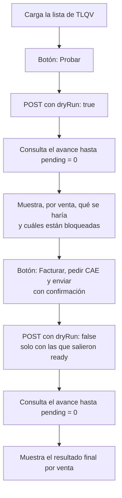

# Guía para el front: entrega en el día en lote

Todo lo que hace falta para sumar al panel el proceso que **factura, pide el CAE y envía la factura a Mercado Libre** de una sola vez, para varias ventas.

← [Volver al inicio](../README.md)

**Contenido**

- [Qué hace la pantalla](#qué-hace-la-pantalla)
- [Los dos endpoints](#los-dos-endpoints)
- [Flujo recomendado](#flujo-recomendado)
- [Cómo leer el resultado de cada venta](#cómo-leer-el-resultado-de-cada-venta)
- [Qué hacer con las que se detuvieron](#qué-hacer-con-las-que-se-detuvieron)
- [Reglas de la pantalla](#reglas-de-la-pantalla)
- [Acciones sueltas](#acciones-sueltas)
- [Tipos](#tipos)
- [Ejemplos de respuesta](#ejemplos-de-respuesta)

---

## Qué hace la pantalla

Quien factura carga una **lista de TLQV** de ventas con entrega en el día. Por cada una, el sistema hace tres pasos seguidos:

1. **Emite la factura** en Xubio, desde la orden de Mercado Libre.
2. **Pide el CAE** a AFIP.
3. **Envía la factura** a Mercado Libre, donde la ve el comprador.

Las ventas no se procesan mientras dura el pedido: **se encolan** y el sistema las va haciendo **de a una**. La pantalla manda la lista, recibe un identificador del lote y después **consulta el avance**.

Si una venta no puede seguir en algún paso, se detiene ahí y el lote sigue con la próxima. El criterio de negocio está en la [guía funcional](funcional.md#todo-de-una-vez-en-lote).

Para facturar **una sola venta viendo la factura antes**, sigue existiendo la pantalla de [una venta por vez](front-entrega-en-el-dia.md).

---

## Los dos endpoints

Se llaman igual que el resto de Invoice API: mismo host y mismo header `x-internal-api-key`. La clave no tiene que quedar expuesta en el navegador.

### Mandar el lote

```
POST /internal/tlqv-invoice/facturas/bulk/entrega-en-el-dia
```

| Campo | Tipo | Obligatorio | Descripción |
|---|---|---|---|
| `tlqvCodes` | string[] | Sí | Las ventas. Al menos una. Acepta mayúsculas o minúsculas; los repetidos se cuentan una vez. |
| `dryRun` | boolean | No | `true` = prueba: no emite, no pide el CAE, no envía. `false` = lo hace de verdad. **Si no se envía, es `true`.** Tiene que ser un booleano de JSON: el texto `"false"` devuelve `400`. |
| `issueDate` | string | No | Fecha de emisión para todas, `YYYY-MM-DD`. Hasta 10 días hacia atrás; no puede ser futura. |

Responde enseguida, sin esperar a que se procesen:

| Campo | Qué trae |
|---|---|
| `batchId` | **El identificador del lote.** Hay que guardarlo: es con lo que se consulta el avance. |
| `totalQueued` | Cuántas ventas entraron. |
| `totalDuplicated` | Cuántas venían repetidas en la lista. |
| `tlqvCodes` | Las ventas que entraron, ya normalizadas. |
| `dryRun` | Si el lote es de prueba. |

### Consultar el avance

```
GET /internal/tlqv-invoice/facturas/bulk/entrega-en-el-dia/:batchId
```

| Campo | Qué trae |
|---|---|
| `found` | `false` si no existe un lote con ese identificador. |
| `totalJobs` | Cuántas ventas tiene el lote. |
| `results` | Los totales: `completed`, `ready`, `blocked`, `blockedAtInvoice`, `blockedAtCae`, `blockedAtMeli`, `failed`, `pending`. |
| `jobs` | Una fila por venta, con su resultado. |

**El lote terminó cuando `results.pending` es `0`.**

### Códigos HTTP

| Código | Cuándo |
|---|---|
| `200` / `201` | El pedido se procesó. |
| `400` | Falta `tlqvCodes`, está vacío, o `dryRun` / `issueDate` tienen un formato inválido. |
| `401` | Falta la clave o es incorrecta. |
| `503` | La cola no está disponible. No se encoló nada: se puede reintentar. |

---

## Flujo recomendado



**Primero la prueba.** Con `dryRun: true` se ve qué ventas se pueden procesar y cuáles no, sin emitir, pedir ni enviar nada. Lo único que puede quedar hecho es la ficha del cliente en Xubio, si no existía. Después se manda el lote real **solo con las que salieron `ready`**.

**Pedir confirmación antes del lote real.** Con `dryRun: false` no hay vuelta atrás: la factura sale con CAE y le llega al comprador. Corregirla después requiere una nota de crédito. El texto de confirmación tiene que decir cuántas ventas son.

**Consultar el avance cada 5 segundos**, hasta que `results.pending` sea `0`. Cada venta tarda entre unos segundos y un minuto, así que un lote de 20 puede llevar varios minutos. Mostrar el progreso: `totalJobs - results.pending` de `totalJobs`.

---

## Cómo leer el resultado de cada venta

Cada fila de `jobs` es una venta. Lo primero que hay que mirar es **`state`**, que dice si ya se procesó:

| `state` | Significado | Qué mostrar |
|---|---|---|
| `waiting` · `delayed` · `paused` | En la cola, todavía no empezó. | "En espera" |
| `active` | Se está procesando ahora. | "Procesando" |
| `completed` | Se procesó. El resultado está en `status`. | Según `status` |
| `failed` | Error inesperado. El detalle está en `failedReason`. | "Error", con el detalle |

Cuando `state` es `completed`, el resultado es **`status`**:

| `status` | Significado |
|---|---|
| `completed` | La venta quedó terminada: tiene factura, con CAE, cargada en Mercado Libre. |
| `ready` | Solo en prueba: no hay nada que lo impida. |
| `blocked` | Se detuvo en un paso. Cuál, en `stoppedAt`; por qué, en `message`. |

> **Cuidado con los dos "completed".** `state: "completed"` significa que el trabajo terminó de procesarse, bien o mal. `status: "completed"` significa que la venta quedó facturada, con CAE y enviada. Una venta puede tener `state: "completed"` y `status: "blocked"`.

Los tres pasos se informan por separado, para mostrar una columna por cada uno:

| Campo | Valor | Qué mostrar |
|---|---|---|
| `invoiceStatus` | `created` | Factura emitida ahora |
| | `existing` | Ya tenía factura; se siguió con esa |
| | `ready` | (prueba) Se emitiría |
| | `blocked` | No se pudo emitir |
| `caeStatus` | `authorized` | CAE otorgado ahora |
| | `already_had` | Ya tenía CAE |
| | `ready` | (prueba) Se pediría |
| | `pending` | No se llegó a este paso |
| | `blocked` | No se obtuvo |
| `meliStatus` | `sent` | Enviada ahora |
| | `already_sent` | Mercado Libre ya la tenía |
| | `ready` | (prueba) Se enviaría |
| | `pending` | No se llegó a este paso |
| | `blocked` | No se pudo enviar |

Y los datos de la factura:

| Dato | Campo |
|---|---|
| Número de comprobante | `numeroDocumento` — ej. `B-00008-00004100` |
| ID en Xubio | `transaccionId` |
| Total | `totalAmount` |
| CAE | `cae` |
| Orden de Mercado Libre | `meliOrderId` |

**En una prueba de una venta sin factura**, solo viene `invoiceStatus: "ready"` y el total. Los otros dos pasos salen `pending`: no se pueden probar hasta que la factura exista.

---

## Qué hacer con las que se detuvieron

Una venta con `status: "blocked"` quedó a mitad de camino. **Lo que ya se hizo, queda hecho.** `stoppedAt` dice dónde quedó:

| `stoppedAt` | Cómo quedó la venta | Qué mostrar |
|---|---|---|
| `invoice` | **Sin factura.** No se hizo nada. | El motivo (`message`). Son los mismos bloqueos que en la pantalla de una venta: ver [cuando no se puede facturar](front-entrega-en-el-dia.md#cuando-no-se-puede-facturar). |
| `cae` | **Con factura, sin CAE.** | El número de factura y el motivo. Avisar que la factura existe pero todavía no es válida. |
| `meli` | **Con factura y CAE, sin enviar.** | El número de factura, el CAE y el motivo. |

En los tres casos la salida es la misma: **resolver el motivo y volver a mandar esa venta en otro lote.** El sistema retoma desde donde quedó:

- No emite otra factura si la venta ya tiene una.
- No pide un CAE que ya tiene.
- No manda a Mercado Libre una factura que ya está cargada.

Por eso es seguro ofrecer un botón **"Reintentar las detenidas"**, que arme un lote nuevo con las ventas `blocked`. Una venta que ya estaba terminada, si se manda de nuevo, sale `completed` sin tocar nada.

`blockerCodes` trae los códigos, por si la pantalla quiere tratar alguno en particular. El catálogo completo, con qué hacer en cada caso, está en [Bloqueos](bloqueos.md). Para todo lo demás, alcanza con mostrar `message`: está escrito para que lo lea una persona.

**Las ventas detenidas quedan registradas solas** y aparecen en el listado de issues que el panel ya consume (`GET /internal/tlqv-invoice/issues`).

---

## Reglas de la pantalla

**Bloquear el doble envío.** Deshabilitar los botones mientras el pedido de mandar el lote está en curso.

**Guardar el `batchId`.** Si la persona recarga la página, con el `batchId` se puede volver a mostrar el lote. Conviene dejarlo en la URL.

**Un lote a la vez por persona.** Las ventas se procesan de a una entre todos los lotes, así que mandar dos lotes no acelera nada.

**Mostrar el aviso `warning`.** Si una fila trae `warning`, la factura se emitió pero no se pudo guardar en el registro que controla los duplicados. Mostrarlo destacado y **no ofrecer reintentar esa venta**: durante las dos horas siguientes el sistema no la vería y emitiría otra factura.

**Si `failed` es mayor que `0`**, hubo un error inesperado en esas ventas. No se sabe en qué paso quedaron: mostrar `failedReason` y pedir que se revise la venta en Xubio antes de reintentarla.

**Enviar siempre la fecha.** Mandar `issueDate` con la fecha del día en **hora de Argentina**. Si no se envía, el servidor usa su propia fecha, que entre las 21:00 y la medianoche ya es la del día siguiente.

**Los lotes viejos se borran.** El resultado de un lote se puede consultar durante un tiempo, no para siempre. Si `found` viene `false`, mostrar "No se encontró el lote" y no un error.

---

## Acciones sueltas

Los pasos 2 y 3 también existen por separado. Sirven para una venta que quedó a mitad de camino, o para facturas hechas por otro proceso. No son necesarios para la pantalla del lote: reenviar la venta hace lo mismo.

| Acción | Endpoint | Body |
|---|---|---|
| Pedir el CAE de una venta | `POST /internal/tlqv-invoice/facturas/cae` | `{ "tlqvCode": "TLQV-23500", "dryRun": false }` |
| Pedir el CAE de varias | `POST /internal/tlqv-invoice/facturas/bulk/cae` | `{ "tlqvCodes": ["TLQV-23500"], "dryRun": false }` |
| Enviar la factura a Mercado Libre | `POST /internal/tlqv-invoice/facturas/send-to-meli` | `{ "tlqvCode": "TLQV-23500", "dryRun": false }` |

Los tres arrancan en prueba (`dryRun: true`) y responden con un `status` y, si no se pudo, con `blockers`. El detalle de cada uno está en la [referencia de la API](api.md#cae).

---

## Tipos

```ts
// POST /internal/tlqv-invoice/facturas/bulk/entrega-en-el-dia
interface EnqueueRequest {
  tlqvCodes: string[];
  dryRun?: boolean; // por defecto true
  issueDate?: string; // YYYY-MM-DD
}

interface EnqueueResponse {
  status: 'queued';
  queueName: string;
  batchId: string;
  dryRun: boolean;
  issueDate?: string;
  totalRequested: number;
  totalDuplicated: number;
  totalQueued: number;
  bullBoardPath: string;
  tlqvCodes: string[];
}

// GET /internal/tlqv-invoice/facturas/bulk/entrega-en-el-dia/:batchId
type JobState =
  | 'completed'
  | 'failed'
  | 'active'
  | 'waiting'
  | 'delayed'
  | 'paused';

type SaleStatus = 'completed' | 'ready' | 'blocked';
type Stage = 'invoice' | 'cae' | 'meli';

interface BatchJob {
  jobId: string;
  tlqvCode: string;
  state: JobState;
  failedReason?: string;

  // Lo que sigue solo viene cuando state es 'completed'.
  status?: SaleStatus;
  stoppedAt?: Stage | null;
  invoiceStatus?: 'created' | 'existing' | 'ready' | 'blocked';
  transaccionId?: number | null;
  numeroDocumento?: string | null;
  totalAmount?: number | null;
  caeStatus?: 'authorized' | 'already_had' | 'ready' | 'pending' | 'blocked';
  cae?: string | null;
  meliStatus?: 'sent' | 'already_sent' | 'ready' | 'pending' | 'blocked';
  meliOrderId?: string | null;
  blockerCodes?: string[];
  message?: string | null;
  warning?: string | null;
}

interface BatchStatusResponse {
  batchId: string;
  queueName: string;
  found: boolean;
  totalJobs: number;
  counts: Record<JobState, number>;
  results: {
    completed: number;
    ready: number;
    blocked: number;
    blockedAtInvoice: number;
    blockedAtCae: number;
    blockedAtMeli: number;
    failed: number;
    pending: number;
  };
  jobs: BatchJob[];
}
```

---

## Ejemplos de respuesta

### Lote encolado

```json
{
  "status": "queued",
  "queueName": "tlqv-invoice-entrega-en-el-dia-bulk",
  "batchId": "tlqv-entrega-en-el-dia-2026-11-27T15-00-00-000Z-a1b2c3d4",
  "dryRun": false,
  "issueDate": "2026-11-27",
  "totalRequested": 3,
  "totalDuplicated": 0,
  "totalQueued": 3,
  "bullBoardPath": "/admin/queues",
  "tlqvCodes": ["TLQV-23500", "TLQV-23501", "TLQV-23502"]
}
```

### Avance — una terminada, una detenida en el CAE, una en espera

```json
{
  "batchId": "tlqv-entrega-en-el-dia-2026-11-27T15-00-00-000Z-a1b2c3d4",
  "queueName": "tlqv-invoice-entrega-en-el-dia-bulk",
  "found": true,
  "totalJobs": 3,
  "counts": { "completed": 2, "failed": 0, "active": 0, "waiting": 1, "delayed": 0, "paused": 0 },
  "results": {
    "completed": 1,
    "ready": 0,
    "blocked": 1,
    "blockedAtInvoice": 0,
    "blockedAtCae": 1,
    "blockedAtMeli": 0,
    "failed": 0,
    "pending": 1
  },
  "jobs": [
    {
      "jobId": "tlqv-entrega-en-el-dia:tlqv-entrega-en-el-dia-2026-11-27T15-00-00-000Z-a1b2c3d4:TLQV-23500",
      "tlqvCode": "TLQV-23500",
      "state": "completed",
      "status": "completed",
      "stoppedAt": null,
      "invoiceStatus": "created",
      "transaccionId": 80000001,
      "numeroDocumento": "B-00008-00004100",
      "totalAmount": 386749.16,
      "caeStatus": "authorized",
      "cae": "86484580124099",
      "meliStatus": "sent",
      "meliOrderId": "2000019813708728",
      "blockerCodes": [],
      "message": null,
      "warning": null
    },
    {
      "jobId": "tlqv-entrega-en-el-dia:tlqv-entrega-en-el-dia-2026-11-27T15-00-00-000Z-a1b2c3d4:TLQV-23501",
      "tlqvCode": "TLQV-23501",
      "state": "completed",
      "status": "blocked",
      "stoppedAt": "cae",
      "invoiceStatus": "created",
      "transaccionId": 80000002,
      "numeroDocumento": "A-00008-00004101",
      "totalAmount": 622999,
      "caeStatus": "blocked",
      "cae": null,
      "meliStatus": "pending",
      "meliOrderId": null,
      "blockerCodes": ["CAE_REJECTED"],
      "message": "No se obtuvo el CAE del comprobante A-00008-00004101. ...",
      "warning": null
    },
    {
      "jobId": "tlqv-entrega-en-el-dia:tlqv-entrega-en-el-dia-2026-11-27T15-00-00-000Z-a1b2c3d4:TLQV-23502",
      "tlqvCode": "TLQV-23502",
      "state": "waiting"
    }
  ]
}
```

### Prueba — una lista para procesar y una que no se puede facturar

```json
{
  "found": true,
  "totalJobs": 2,
  "results": {
    "completed": 0,
    "ready": 1,
    "blocked": 1,
    "blockedAtInvoice": 1,
    "blockedAtCae": 0,
    "blockedAtMeli": 0,
    "failed": 0,
    "pending": 0
  },
  "jobs": [
    {
      "tlqvCode": "TLQV-23500",
      "state": "completed",
      "status": "ready",
      "stoppedAt": null,
      "invoiceStatus": "ready",
      "transaccionId": null,
      "numeroDocumento": null,
      "totalAmount": 386749.16,
      "caeStatus": "pending",
      "cae": null,
      "meliStatus": "pending",
      "meliOrderId": null,
      "blockerCodes": [],
      "message": null,
      "warning": null
    },
    {
      "tlqvCode": "TLQV-23503",
      "state": "completed",
      "status": "blocked",
      "stoppedAt": "invoice",
      "invoiceStatus": "blocked",
      "transaccionId": null,
      "numeroDocumento": null,
      "totalAmount": null,
      "caeStatus": "pending",
      "cae": null,
      "meliStatus": "pending",
      "meliOrderId": null,
      "blockerCodes": ["INVOICE_TOTAL_SALE_PRICE_MISMATCH"],
      "message": "...",
      "warning": null
    }
  ]
}
```

### El lote no existe

```json
{
  "batchId": "tlqv-entrega-en-el-dia-inexistente",
  "queueName": "tlqv-invoice-entrega-en-el-dia-bulk",
  "found": false,
  "totalJobs": 0,
  "counts": { "completed": 0, "failed": 0, "active": 0, "waiting": 0, "delayed": 0, "paused": 0 },
  "results": {
    "completed": 0,
    "ready": 0,
    "blocked": 0,
    "blockedAtInvoice": 0,
    "blockedAtCae": 0,
    "blockedAtMeli": 0,
    "failed": 0,
    "pending": 0
  },
  "jobs": []
}
```
