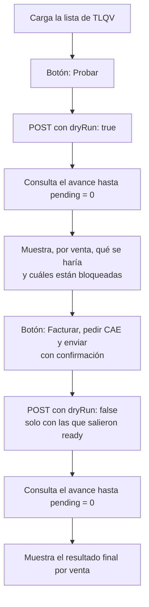

# Guía para el front: entrega en el día en lote

Todo lo que hace falta para sumar al panel el proceso que **factura, pide el CAE y envía la factura a Mercado Libre** de una sola vez, para varias ventas. Incluye también los dos pasos por separado: **pedir el CAE** y **enviar la factura a Mercado Libre**.

← [Volver al inicio](../README.md)

**Contenido**

- [Qué hace la pantalla](#qué-hace-la-pantalla)
- [Los dos endpoints](#los-dos-endpoints)
- [Flujo recomendado](#flujo-recomendado)
- [Cómo leer el resultado de cada venta](#cómo-leer-el-resultado-de-cada-venta)
- [Qué hacer con las que se detuvieron](#qué-hacer-con-las-que-se-detuvieron)
- [Reglas de la pantalla](#reglas-de-la-pantalla)
- [Tipos](#tipos)
- [Ejemplos de respuesta](#ejemplos-de-respuesta)
- [Pedir el CAE por separado](#pedir-el-cae-por-separado)
- [Enviar la factura a Mercado Libre por separado](#enviar-la-factura-a-mercado-libre-por-separado)
- [Resumen de endpoints](#resumen-de-endpoints)

---

## Qué hace la pantalla

Quien factura carga una **lista de TLQV** de ventas con entrega en el día. Por cada una, el sistema hace tres pasos seguidos:

1. **Emite la factura** en Xubio, desde la orden de Mercado Libre.
2. **Pide el CAE** a AFIP.
3. **Envía la factura** a Mercado Libre, donde la ve el comprador.

Las ventas no se procesan mientras dura el pedido: **se encolan** y el sistema las va haciendo **de a una**. La pantalla manda la lista, recibe un identificador del lote y después **consulta el avance**.

Si una venta no puede seguir en algún paso, se detiene ahí y el lote sigue con la próxima. El criterio de negocio está en la [guía funcional](funcional.md#todo-de-una-vez-en-lote).

Para facturar **una sola venta viendo la factura antes**, sigue existiendo la pantalla de [una venta por vez](front-entrega-en-el-dia.md).

---

## Los dos endpoints

Se llaman igual que el resto de Invoice API: mismo host y mismo header `x-internal-api-key`. La clave no tiene que quedar expuesta en el navegador.

### Mandar el lote

```
POST /internal/tlqv-invoice/facturas/bulk/entrega-en-el-dia
```

| Campo | Tipo | Obligatorio | Descripción |
|---|---|---|---|
| `tlqvCodes` | string[] | Sí | Las ventas. Al menos una. Acepta mayúsculas o minúsculas; los repetidos se cuentan una vez. |
| `dryRun` | boolean | No | `true` = prueba: no emite, no pide el CAE, no envía. `false` = lo hace de verdad. **Si no se envía, es `true`.** Tiene que ser un booleano de JSON: el texto `"false"` devuelve `400`. |
| `issueDate` | string | No | Fecha de emisión para todas, `YYYY-MM-DD`. Hasta 10 días hacia atrás; no puede ser futura. |

Responde enseguida, sin esperar a que se procesen:

| Campo | Qué trae |
|---|---|
| `batchId` | **El identificador del lote.** Hay que guardarlo: es con lo que se consulta el avance. |
| `totalQueued` | Cuántas ventas entraron. |
| `totalDuplicated` | Cuántas venían repetidas en la lista. |
| `tlqvCodes` | Las ventas que entraron, ya normalizadas. |
| `dryRun` | Si el lote es de prueba. |

### Consultar el avance

```
GET /internal/tlqv-invoice/facturas/bulk/entrega-en-el-dia/:batchId
```

| Campo | Qué trae |
|---|---|
| `found` | `false` si no existe un lote con ese identificador. |
| `totalJobs` | Cuántas ventas tiene el lote. |
| `results` | Los totales: `completed`, `ready`, `blocked`, `blockedAtInvoice`, `blockedAtCae`, `blockedAtMeli`, `failed`, `pending`. |
| `jobs` | Una fila por venta, con su resultado. |

**El lote terminó cuando `results.pending` es `0`.**

### Códigos HTTP

| Código | Cuándo |
|---|---|
| `200` / `201` | El pedido se procesó. |
| `400` | Falta `tlqvCodes`, está vacío, o `dryRun` / `issueDate` tienen un formato inválido. |
| `401` | Falta la clave o es incorrecta. |
| `503` | La cola no está disponible. No se encoló nada: se puede reintentar. |

---

## Flujo recomendado



**Primero la prueba.** Con `dryRun: true` se ve qué ventas se pueden procesar y cuáles no, sin emitir, pedir ni enviar nada. Lo único que puede quedar hecho es la ficha del cliente en Xubio, si no existía. Después se manda el lote real **solo con las que salieron `ready`**.

**Pedir confirmación antes del lote real.** Con `dryRun: false` no hay vuelta atrás: la factura sale con CAE y le llega al comprador. Corregirla después requiere una nota de crédito. El texto de confirmación tiene que decir cuántas ventas son.

**Consultar el avance cada 5 segundos**, hasta que `results.pending` sea `0`. Cada venta tarda entre unos segundos y un minuto, así que un lote de 20 puede llevar varios minutos. Mostrar el progreso: `totalJobs - results.pending` de `totalJobs`.

---

## Cómo leer el resultado de cada venta

Cada fila de `jobs` es una venta. Lo primero que hay que mirar es **`state`**, que dice si ya se procesó:

| `state` | Significado | Qué mostrar |
|---|---|---|
| `waiting` · `delayed` · `paused` | En la cola, todavía no empezó. | "En espera" |
| `active` | Se está procesando ahora. | "Procesando" |
| `completed` | Se procesó. El resultado está en `status`. | Según `status` |
| `failed` | Error inesperado. El detalle está en `failedReason`. | "Error", con el detalle |

Cuando `state` es `completed`, el resultado es **`status`**:

| `status` | Significado |
|---|---|
| `completed` | La venta quedó terminada: tiene factura, con CAE, cargada en Mercado Libre. |
| `ready` | Solo en prueba: no hay nada que lo impida. |
| `blocked` | Se detuvo en un paso. Cuál, en `stoppedAt`; por qué, en `message`. |

> **Cuidado con los dos "completed".** `state: "completed"` significa que el trabajo terminó de procesarse, bien o mal. `status: "completed"` significa que la venta quedó facturada, con CAE y enviada. Una venta puede tener `state: "completed"` y `status: "blocked"`.

Los tres pasos se informan por separado, para mostrar una columna por cada uno:

| Campo | Valor | Qué mostrar |
|---|---|---|
| `invoiceStatus` | `created` | Factura emitida ahora |
| | `existing` | Ya tenía factura; se siguió con esa |
| | `ready` | (prueba) Se emitiría |
| | `blocked` | No se pudo emitir |
| `caeStatus` | `authorized` | CAE otorgado ahora |
| | `already_had` | Ya tenía CAE |
| | `ready` | (prueba) Se pediría |
| | `pending` | No se llegó a este paso |
| | `blocked` | No se obtuvo |
| `meliStatus` | `sent` | Enviada ahora |
| | `already_sent` | Mercado Libre ya la tenía |
| | `ready` | (prueba) Se enviaría |
| | `pending` | No se llegó a este paso |
| | `blocked` | No se pudo enviar |

Y los datos de la factura:

| Dato | Campo |
|---|---|
| Número de comprobante | `numeroDocumento` — ej. `B-00008-00004100` |
| ID en Xubio | `transaccionId` |
| Total | `totalAmount` |
| CAE | `cae` |
| Orden de Mercado Libre | `meliOrderId` |

**En una prueba de una venta sin factura**, solo viene `invoiceStatus: "ready"` y el total. Los otros dos pasos salen `pending`: no se pueden probar hasta que la factura exista.

---

## Qué hacer con las que se detuvieron

Una venta con `status: "blocked"` quedó a mitad de camino. **Lo que ya se hizo, queda hecho.** `stoppedAt` dice dónde quedó:

| `stoppedAt` | Cómo quedó la venta | Qué mostrar |
|---|---|---|
| `invoice` | **Sin factura.** No se hizo nada. | El motivo (`message`). Son los mismos bloqueos que en la pantalla de una venta: ver [cuando no se puede facturar](front-entrega-en-el-dia.md#cuando-no-se-puede-facturar). |
| `cae` | **Con factura, sin CAE.** | El número de factura y el motivo. Avisar que la factura existe pero todavía no es válida. |
| `meli` | **Con factura y CAE, sin enviar.** | El número de factura, el CAE y el motivo. |

En los tres casos la salida es la misma: **resolver el motivo y volver a mandar esa venta en otro lote.** El sistema retoma desde donde quedó:

- No emite otra factura si la venta ya tiene una.
- No pide un CAE que ya tiene.
- No manda a Mercado Libre una factura que ya está cargada.

Por eso es seguro ofrecer un botón **"Reintentar las detenidas"**, que arme un lote nuevo con las ventas `blocked`. Una venta que ya estaba terminada, si se manda de nuevo, sale `completed` sin tocar nada.

`blockerCodes` trae los códigos, por si la pantalla quiere tratar alguno en particular. El catálogo completo, con qué hacer en cada caso, está en [Bloqueos](bloqueos.md). Para todo lo demás, alcanza con mostrar `message`: está escrito para que lo lea una persona.

**Las ventas detenidas quedan registradas solas** y aparecen en el listado de issues que el panel ya consume (`GET /internal/tlqv-invoice/issues`).

---

## Reglas de la pantalla

**Bloquear el doble envío.** Deshabilitar los botones mientras el pedido de mandar el lote está en curso.

**Guardar el `batchId`.** Si la persona recarga la página, con el `batchId` se puede volver a mostrar el lote. Conviene dejarlo en la URL.

**Un lote a la vez por persona.** Las ventas se procesan de a una entre todos los lotes, así que mandar dos lotes no acelera nada.

**Mostrar el aviso `warning`.** Si una fila trae `warning`, la factura se emitió pero no se pudo guardar en el registro que controla los duplicados. Mostrarlo destacado y **no ofrecer reintentar esa venta**: durante las dos horas siguientes el sistema no la vería y emitiría otra factura.

**Si `failed` es mayor que `0`**, hubo un error inesperado en esas ventas. No se sabe en qué paso quedaron: mostrar `failedReason` y pedir que se revise la venta en Xubio antes de reintentarla.

**Enviar siempre la fecha.** Mandar `issueDate` con la fecha del día en **hora de Argentina**. Si no se envía, el servidor usa su propia fecha, que entre las 21:00 y la medianoche ya es la del día siguiente.

**Los lotes viejos se borran.** El resultado de un lote se puede consultar durante un tiempo, no para siempre. Si `found` viene `false`, mostrar "No se encontró el lote" y no un error.

---

## Tipos

```ts
// POST /internal/tlqv-invoice/facturas/bulk/entrega-en-el-dia
interface EnqueueRequest {
  tlqvCodes: string[];
  dryRun?: boolean; // por defecto true
  issueDate?: string; // YYYY-MM-DD
}

interface EnqueueResponse {
  status: 'queued';
  queueName: string;
  batchId: string;
  dryRun: boolean;
  issueDate?: string;
  totalRequested: number;
  totalDuplicated: number;
  totalQueued: number;
  bullBoardPath: string;
  tlqvCodes: string[];
}

// GET /internal/tlqv-invoice/facturas/bulk/entrega-en-el-dia/:batchId
type JobState =
  | 'completed'
  | 'failed'
  | 'active'
  | 'waiting'
  | 'delayed'
  | 'paused';

type SaleStatus = 'completed' | 'ready' | 'blocked';
type Stage = 'invoice' | 'cae' | 'meli';

interface BatchJob {
  jobId: string;
  tlqvCode: string;
  state: JobState;
  failedReason?: string;

  // Lo que sigue solo viene cuando state es 'completed'.
  status?: SaleStatus;
  stoppedAt?: Stage | null;
  invoiceStatus?: 'created' | 'existing' | 'ready' | 'blocked';
  transaccionId?: number | null;
  numeroDocumento?: string | null;
  totalAmount?: number | null;
  caeStatus?: 'authorized' | 'already_had' | 'ready' | 'pending' | 'blocked';
  cae?: string | null;
  meliStatus?: 'sent' | 'already_sent' | 'ready' | 'pending' | 'blocked';
  meliOrderId?: string | null;
  blockerCodes?: string[];
  message?: string | null;
  warning?: string | null;
}

interface BatchStatusResponse {
  batchId: string;
  queueName: string;
  found: boolean;
  totalJobs: number;
  counts: Record<JobState, number>;
  results: {
    completed: number;
    ready: number;
    blocked: number;
    blockedAtInvoice: number;
    blockedAtCae: number;
    blockedAtMeli: number;
    failed: number;
    pending: number;
  };
  jobs: BatchJob[];
}
```

---

## Ejemplos de respuesta

### Lote encolado

```json
{
  "status": "queued",
  "queueName": "tlqv-invoice-entrega-en-el-dia-bulk",
  "batchId": "tlqv-entrega-en-el-dia-2026-11-27T15-00-00-000Z-a1b2c3d4",
  "dryRun": false,
  "issueDate": "2026-11-27",
  "totalRequested": 3,
  "totalDuplicated": 0,
  "totalQueued": 3,
  "bullBoardPath": "/admin/queues",
  "tlqvCodes": ["TLQV-23500", "TLQV-23501", "TLQV-23502"]
}
```

### Avance — una terminada, una detenida en el CAE, una en espera

```json
{
  "batchId": "tlqv-entrega-en-el-dia-2026-11-27T15-00-00-000Z-a1b2c3d4",
  "queueName": "tlqv-invoice-entrega-en-el-dia-bulk",
  "found": true,
  "totalJobs": 3,
  "counts": { "completed": 2, "failed": 0, "active": 0, "waiting": 1, "delayed": 0, "paused": 0 },
  "results": {
    "completed": 1,
    "ready": 0,
    "blocked": 1,
    "blockedAtInvoice": 0,
    "blockedAtCae": 1,
    "blockedAtMeli": 0,
    "failed": 0,
    "pending": 1
  },
  "jobs": [
    {
      "jobId": "tlqv-entrega-en-el-dia:tlqv-entrega-en-el-dia-2026-11-27T15-00-00-000Z-a1b2c3d4:TLQV-23500",
      "tlqvCode": "TLQV-23500",
      "state": "completed",
      "status": "completed",
      "stoppedAt": null,
      "invoiceStatus": "created",
      "transaccionId": 80000001,
      "numeroDocumento": "B-00008-00004100",
      "totalAmount": 386749.16,
      "caeStatus": "authorized",
      "cae": "86484580124099",
      "meliStatus": "sent",
      "meliOrderId": "2000019813708728",
      "blockerCodes": [],
      "message": null,
      "warning": null
    },
    {
      "jobId": "tlqv-entrega-en-el-dia:tlqv-entrega-en-el-dia-2026-11-27T15-00-00-000Z-a1b2c3d4:TLQV-23501",
      "tlqvCode": "TLQV-23501",
      "state": "completed",
      "status": "blocked",
      "stoppedAt": "cae",
      "invoiceStatus": "created",
      "transaccionId": 80000002,
      "numeroDocumento": "A-00008-00004101",
      "totalAmount": 622999,
      "caeStatus": "blocked",
      "cae": null,
      "meliStatus": "pending",
      "meliOrderId": null,
      "blockerCodes": ["CAE_REJECTED"],
      "message": "No se obtuvo el CAE del comprobante A-00008-00004101. ...",
      "warning": null
    },
    {
      "jobId": "tlqv-entrega-en-el-dia:tlqv-entrega-en-el-dia-2026-11-27T15-00-00-000Z-a1b2c3d4:TLQV-23502",
      "tlqvCode": "TLQV-23502",
      "state": "waiting"
    }
  ]
}
```

### Prueba — una lista para procesar y una que no se puede facturar

```json
{
  "found": true,
  "totalJobs": 2,
  "results": {
    "completed": 0,
    "ready": 1,
    "blocked": 1,
    "blockedAtInvoice": 1,
    "blockedAtCae": 0,
    "blockedAtMeli": 0,
    "failed": 0,
    "pending": 0
  },
  "jobs": [
    {
      "tlqvCode": "TLQV-23500",
      "state": "completed",
      "status": "ready",
      "stoppedAt": null,
      "invoiceStatus": "ready",
      "transaccionId": null,
      "numeroDocumento": null,
      "totalAmount": 386749.16,
      "caeStatus": "pending",
      "cae": null,
      "meliStatus": "pending",
      "meliOrderId": null,
      "blockerCodes": [],
      "message": null,
      "warning": null
    },
    {
      "tlqvCode": "TLQV-23503",
      "state": "completed",
      "status": "blocked",
      "stoppedAt": "invoice",
      "invoiceStatus": "blocked",
      "transaccionId": null,
      "numeroDocumento": null,
      "totalAmount": null,
      "caeStatus": "pending",
      "cae": null,
      "meliStatus": "pending",
      "meliOrderId": null,
      "blockerCodes": ["INVOICE_TOTAL_SALE_PRICE_MISMATCH"],
      "message": "...",
      "warning": null
    }
  ]
}
```

### El lote no existe

```json
{
  "batchId": "tlqv-entrega-en-el-dia-inexistente",
  "queueName": "tlqv-invoice-entrega-en-el-dia-bulk",
  "found": false,
  "totalJobs": 0,
  "counts": { "completed": 0, "failed": 0, "active": 0, "waiting": 0, "delayed": 0, "paused": 0 },
  "results": {
    "completed": 0,
    "ready": 0,
    "blocked": 0,
    "blockedAtInvoice": 0,
    "blockedAtCae": 0,
    "blockedAtMeli": 0,
    "failed": 0,
    "pending": 0
  },
  "jobs": []
}
```

---

## Pedir el CAE por separado

El proceso en lote ya pide el CAE. Estos endpoints sirven para lo que quedó afuera: facturas hechas por la facturación habitual, notas de crédito, o una venta que se quiere resolver sin armar un lote.

> **Un CAE otorgado no se puede deshacer.** Pedir confirmación antes de mandar `dryRun: false`.

### De a uno

```
POST /internal/tlqv-invoice/facturas/cae
```

Se envía `tlqvCode` **o** `transaccionId`, uno de los dos. Mandar los dos, o ninguno, devuelve `400`.

| Campo | Tipo | Descripción |
|---|---|---|
| `tlqvCode` | string | La venta. Pide el CAE de **todos** sus comprobantes que no lo tengan (factura y, si hay, nota de crédito). |
| `transaccionId` | number | El ID del comprobante en Xubio. Pide el CAE de ese solo. |
| `dryRun` | boolean | Por defecto `true`: muestra qué pediría. |

**El pedido espera la respuesta de AFIP.** Puede tardar hasta un minuto por comprobante: usar un tiempo de espera de **120 segundos** y mostrar un indicador de carga.

La respuesta cambia según cómo se pidió:

- Por `transaccionId`: un solo resultado, con `status`, `comprobante` y `blockers`.
- Por `tlqvCode`: un `status` general y la lista `results`, con un resultado por comprobante.

| `status` | Significado | Qué mostrar |
|---|---|---|
| `ready` | Prueba: no tiene CAE y se pediría. | "Se va a pedir el CAE de …" |
| `authorized` | AFIP lo otorgó. Viene en `comprobante.cae`. | El CAE y su vencimiento (`caeFechaVto`). |
| `skipped` | Ya tenía CAE. No se pidió otro. | "Ya tiene CAE", con el número. No es un error. |
| `blocked` | No se obtuvo. | El `message` del bloqueo. |

Por `tlqvCode`, el `status` general es el peor de sus comprobantes: `blocked` si alguno lo está; si no, `authorized`; si no, `ready`; y `skipped` solo si ninguno necesitaba CAE.

`comprobante.tipo` es `1` para una factura y `3` para una nota de crédito.

| Bloqueo | Qué pasó | Qué ofrecer |
|---|---|---|
| `CAE_REJECTED` | AFIP o Xubio no lo otorgaron. El `message` trae el motivo. | Mostrar el motivo. No reintentar solo: hay que corregir algo antes. |
| `CAE_REQUEST_OUTCOME_UNKNOWN` | Xubio no respondió. | **Reintentar.** Es seguro: si el CAE ya había salido, la respuesta viene `skipped`. |
| `NO_COMPROBANTE` | La venta no tiene comprobantes registrados. | Verificar el TLQV. |
| `XUBIO_COMPROBANTE_LOOKUP_FAILED` · `COMPROBANTES_LOOKUP_FAILED` | No se pudo consultar. No se pidió nada. | Reintentar. |

### En lote

```
POST /internal/tlqv-invoice/facturas/bulk/cae
```

| Campo | Tipo | Descripción |
|---|---|---|
| `tlqvCodes` | string[] | Ventas. Entran todos los comprobantes de cada una. |
| `transaccionIds` | number[] | Comprobantes sueltos, por su ID de Xubio. |
| `dryRun` | boolean | Por defecto `true`. |

Hay que mandar al menos una de las dos listas. Funciona igual que el lote de entrega en el día: responde enseguida con un `batchId` y el avance se consulta aparte.

La respuesta trae además:

| Campo | Qué trae |
|---|---|
| `comprobantes` | Lo que entró al lote, **en el orden en que se va a procesar** (del más viejo al más nuevo). |
| `tlqvCodesWithoutComprobante` | Ventas pedidas que **no tienen comprobantes** y quedaron afuera. Mostrarlas: si no, parece que se procesaron. |

Si no se pueden leer los comprobantes, responde `503` y no encola nada.

```
GET /internal/tlqv-invoice/facturas/bulk/cae/:batchId
```

Una fila por **comprobante** (no por venta), con `state` y, cuando terminó, `status`, `numeroDocumento`, `cae`, `caeFechaVto`, `blockerCodes` y `message`. Los totales están en `results`: `authorized`, `ready`, `skipped`, `blocked`, `failed`, `pending`. **Terminó cuando `results.pending` es `0`.**

```ts
type CaeStatus = 'authorized' | 'ready' | 'skipped' | 'blocked';

interface CaeBlocker {
  code: string;
  message: string;
}

interface CaeResult {
  status: CaeStatus;
  transaccionId: number;
  dryRun: boolean;
  comprobante?: {
    transaccionId: number;
    numeroDocumento: string | null;
    tipo: number | null; // 1 factura, 3 nota de crédito
    fecha: string | null;
    importeTotal: number | null;
    cliente: string | null;
    descripcion: string | null;
    cae: string | null;
    caeFechaVto: string | null; // YYYY-MM-DD
  };
  blockers: CaeBlocker[];
  /** Solo cuando se otorgó el CAE. */
  madreSync?: { status: 'synced' | 'failed'; message?: string };
}

// POST /cae con transaccionId → CaeResult
// POST /cae con tlqvCode → CaeForTlqvResponse
interface CaeForTlqvResponse {
  status: CaeStatus;
  tlqvCode: string;
  dryRun: boolean;
  results: CaeResult[];
  blockers: CaeBlocker[];
}

// POST /bulk/cae
interface CaeBulkEnqueueResponse {
  status: 'queued';
  queueName: string;
  batchId: string;
  dryRun: boolean;
  totalQueued: number;
  tlqvCodesWithoutComprobante: string[];
  bullBoardPath: string;
  comprobantes: {
    transaccionId: number;
    tlqvCode: string | null;
    numeroDocumento: string | null;
  }[];
}

// GET /bulk/cae/:batchId
interface CaeBatchStatusResponse {
  batchId: string;
  queueName: string;
  found: boolean;
  totalJobs: number;
  counts: Record<JobState, number>;
  results: {
    authorized: number;
    ready: number;
    skipped: number;
    blocked: number;
    failed: number;
    pending: number;
  };
  jobs: {
    jobId: string;
    transaccionId: number;
    tlqvCode: string | null;
    state: JobState;
    failedReason?: string;
    // Lo que sigue solo viene cuando state es 'completed'.
    status?: CaeStatus;
    numeroDocumento?: string | null;
    cae?: string | null;
    caeFechaVto?: string | null;
    blockerCodes?: string[];
    message?: string | null;
  }[];
}
```

**Ejemplo — CAE otorgado, pedido por TLQV**

```json
{
  "status": "authorized",
  "tlqvCode": "TLQV-22281",
  "dryRun": false,
  "results": [
    {
      "status": "authorized",
      "transaccionId": 79915082,
      "dryRun": false,
      "comprobante": {
        "transaccionId": 79915082,
        "numeroDocumento": "A-00008-00004095",
        "tipo": 1,
        "fecha": "2026-11-26",
        "importeTotal": 622999,
        "cliente": "CASA MAINI SRL",
        "descripcion": "TLQV-22281 ML: 2000019102174568",
        "cae": "86484580124007",
        "caeFechaVto": "2026-12-06"
      },
      "blockers": [],
      "madreSync": { "status": "synced" }
    }
  ],
  "blockers": []
}
```

**Ejemplo — ya tenía CAE**

```json
{
  "status": "skipped",
  "transaccionId": 79915082,
  "dryRun": false,
  "comprobante": { "numeroDocumento": "A-00008-00004095", "cae": "86484580124007", "caeFechaVto": "2026-12-06" },
  "blockers": [
    {
      "code": "ALREADY_HAS_CAE",
      "message": "El comprobante A-00008-00004095 ya tiene CAE (86484580124007). No se pide otro."
    }
  ]
}
```

---

## Enviar la factura a Mercado Libre por separado

```
POST /internal/tlqv-invoice/facturas/send-to-meli
```

Adjunta el PDF de la factura a la venta en Mercado Libre, donde la ve el comprador. Es de **una venta por vez**.

> **La subida no se puede deshacer.** Pedir confirmación antes de mandar `dryRun: false`.

| Campo | Tipo | Obligatorio | Descripción |
|---|---|---|---|
| `tlqvCode` | string | Sí | La venta. |
| `dryRun` | boolean | No | Por defecto `true`: verifica todo y arma el PDF, sin subirlo. |
| `force` | boolean | No | Por defecto `false`. Con `true` sube aunque la venta ya tenga una factura en Mercado Libre. Es solo para la **factura nueva después de una nota de crédito**. |
| `transaccionId` | number | No | Para enviar una factura puntual por su ID de Xubio. Normalmente no hace falta. |

Usar un tiempo de espera de **120 segundos**.

| `status` | Significado | Qué mostrar |
|---|---|---|
| `ready` | Prueba: todo en orden, se enviaría esta factura. | Número, CAE, total y orden de Mercado Libre, y el botón para enviar. |
| `sent` | Subida a Mercado Libre. | "Factura enviada al comprador." |
| `skipped` | La venta **ya tenía** una factura en Mercado Libre. No se subió otra. | "Mercado Libre ya tiene una factura para esta venta." No es un error. |
| `blocked` | No se puede enviar. | El `message` del bloqueo. |

| Bloqueo | Qué pasó | Qué ofrecer |
|---|---|---|
| `INVOICE_WITHOUT_CAE` | La factura todavía no tiene CAE. | Pedir el CAE primero. |
| `NO_LIVE_INVOICE` | La venta no tiene factura, o está anulada por nota de crédito. El `message` dice cuál. | Facturar primero. |
| `MELI_ORDER_NOT_LINKED` | La venta no es de Mercado Libre. | Nada: no corresponde enviar. |
| `MELI_INVOICE_UPLOAD_FAILED` | Mercado Libre no la aceptó o no respondió. | **Reintentar.** Es seguro: si la subida llegó a hacerse, el reintento sale `skipped`. |
| `MELI_INVOICE_ALREADY_SENT` | Viene con `status: "skipped"`. | Solo si es una factura nueva tras una nota de crédito, ofrecer "Reemplazar" (`force: true`), con confirmación. |
| Cualquier otro | No se pudo consultar algún servicio, o falló el PDF. | Mostrar el `message` y permitir reintentar. |

```ts
interface SendToMeliRequest {
  tlqvCode: string;
  dryRun?: boolean; // por defecto true
  force?: boolean; // por defecto false
  transaccionId?: number;
}

interface SendToMeliResponse {
  status: 'sent' | 'ready' | 'skipped' | 'blocked';
  tlqvCode: string;
  dryRun: boolean;
  invoice?: {
    xubioTransactionId: number;
    numeroDocumento: string | null;
    cae: string;
    fechaEmision: string | null;
    importeTotal: number | null;
  };
  meliOrderId?: string;
  meliPackId?: string | null;
  pdf?: { fileName: string; sizeInBytes: number };
  meliResponse?: unknown;
  blockers: { code: string; message: string }[];
}
```

**Ejemplo — prueba, lista para enviar**

```json
{
  "status": "ready",
  "tlqvCode": "TLQV-22281",
  "dryRun": true,
  "invoice": {
    "xubioTransactionId": 79915082,
    "numeroDocumento": "A-00008-00004095",
    "cae": "86484580124007",
    "fechaEmision": "2026-11-26T00:00:00.000Z",
    "importeTotal": 622999
  },
  "meliOrderId": "2000019102174568",
  "meliPackId": "2000015640314189",
  "pdf": { "fileName": "A-00008-00004095.pdf", "sizeInBytes": 107407 },
  "blockers": []
}
```

**Ejemplo — sin CAE**

```json
{
  "status": "blocked",
  "tlqvCode": "TLQV-23501",
  "dryRun": true,
  "blockers": [
    {
      "code": "INVOICE_WITHOUT_CAE",
      "message": "La factura A-00008-00004101 de TLQV-23501 todavía no tiene CAE. Pedí el CAE y reintentá: sin CAE la factura no es válida para el cliente."
    }
  ]
}
```

---

## Resumen de endpoints

Todos bajo `/internal/tlqv-invoice/facturas`, con el header `x-internal-api-key`. Todos arrancan en prueba: sin `dryRun: false` no hacen nada definitivo.

| Qué | Método y ruta |
|---|---|
| Facturar + CAE + enviar, en lote | `POST /bulk/entrega-en-el-dia` |
| Avance de ese lote | `GET /bulk/entrega-en-el-dia/:batchId` |
| Pedir el CAE de una venta o comprobante | `POST /cae` |
| Pedir el CAE en lote | `POST /bulk/cae` |
| Avance del lote de CAE | `GET /bulk/cae/:batchId` |
| Enviar la factura a Mercado Libre | `POST /send-to-meli` |
| Facturar una venta, viendo la factura antes | `POST /create-from-meli-order` — [guía aparte](front-entrega-en-el-dia.md) |

**Un campo nuevo en las respuestas que ya existían.** Cuando una llamada emite una factura o una nota de crédito, o consigue un CAE, la respuesta ahora trae `madreSync`:

```json
"madreSync": { "status": "synced" }
```

Con `"status": "failed"` viene además un `message`. El comprobante igual quedó emitido, pero durante las dos horas siguientes el sistema no lo ve al controlar duplicados: **mostrar el mensaje y no permitir volver a facturar esa venta**. Aplica a `create-from-tlqv`, `create-from-meli-order`, `nota-credito` y `cae`.
