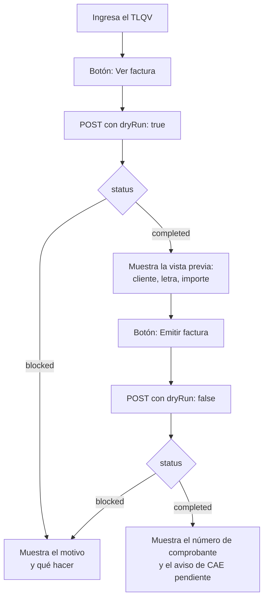

# Guía para el front: facturar ventas con entrega en el día

Todo lo que hace falta para sumar al panel la facturación desde la orden de Mercado Libre.

← [Volver al inicio](../README.md)

**Contenido**

- [Qué hace la pantalla](#qué-hace-la-pantalla)
- [El endpoint](#el-endpoint)
- [Flujo recomendado](#flujo-recomendado)
- [Qué mostrar en la vista previa](#qué-mostrar-en-la-vista-previa)
- [Qué mostrar al emitir](#qué-mostrar-al-emitir)
- [Cuando no se puede facturar](#cuando-no-se-puede-facturar)
- [Reglas de la pantalla](#reglas-de-la-pantalla)
- [Tipos](#tipos)
- [Ejemplos de respuesta](#ejemplos-de-respuesta)

---

## Qué hace la pantalla

Quien factura ingresa un **TLQV** y el sistema emite la factura en Xubio tomando el importe y el comprador de la **orden de Mercado Libre**. Es para las ventas que se entregan en el día.

Es un proceso distinto del de facturación habitual, con su propio endpoint. La pantalla es de **una venta por vez** y solo emite la factura. Para facturar, pedir el CAE y enviar a Mercado Libre una lista de ventas de una sola vez, está la [guía del proceso en lote](front-entrega-en-el-dia-lote.md).

El criterio de negocio —qué importe se factura, cuándo sale A o B, qué se controla— está en la [guía funcional](funcional.md#ventas-con-entrega-en-el-día). Acá va solo lo que necesita la pantalla.

---

## El endpoint

```
POST /internal/tlqv-invoice/facturas/create-from-meli-order
```

Se llama igual que el resto de Invoice API: mismo host y mismo header `x-internal-api-key`. La clave no tiene que quedar expuesta en el navegador.

**Body**

| Campo | Tipo | Obligatorio | Descripción |
|---|---|---|---|
| `tlqvCode` | string | Sí | El TLQV. Acepta mayúsculas o minúsculas. |
| `dryRun` | boolean | No | `true` = vista previa, no emite. `false` = emite. **Si no se envía, es `true`.** Tiene que ser un booleano de JSON: el texto `"false"` devuelve `400`. |
| `issueDate` | string | No | Fecha de emisión, `YYYY-MM-DD`. Hasta 10 días hacia atrás; no puede ser futura. |

**Es el mismo endpoint para la vista previa y para emitir.** Lo único que cambia es `dryRun`.

**Respuesta HTTP**

| Código | Cuándo |
|---|---|
| `200` | Siempre que el pedido se procesó — **también cuando la venta no se puede facturar**. Hay que mirar `status` en el cuerpo. |
| `400` | Falta `tlqvCode`, o `dryRun` / `issueDate` tienen un formato inválido. |
| `401` | Falta la clave o es incorrecta. |
| `500` | Error inesperado. Mostrar un mensaje genérico y permitir reintentar. |

El campo que decide todo es **`status`**:

| `status` | Significado |
|---|---|
| `completed` | Salió bien. Si era vista previa, la factura está armada. Si era emisión, está emitida. |
| `blocked` | No se puede facturar. El motivo está en `blockers`. |

---

## Flujo recomendado

Dos pasos, con confirmación en el medio:



1. **Vista previa.** Se llama con `dryRun: true`. Muestra qué factura saldría, sin emitirla.
2. **Emisión.** Recién cuando la persona confirma, se llama de nuevo con `dryRun: false`.

La vista previa no es opcional en términos de experiencia: es lo que le permite a quien factura ver el cliente, la letra y el importe antes de generar un comprobante fiscal.

> La vista previa **ya busca o crea al cliente en Xubio** si no existía. Lo único que no hace es emitir la factura. No hay que advertirlo en pantalla, pero conviene saberlo.

---

## Qué mostrar en la vista previa

Respuesta con `status: "completed"` y `dryRun: true`.

| En pantalla | Campo de la respuesta |
|---|---|
| TLQV | `tlqvCode` |
| Orden de Mercado Libre | `invoiceBuild.meliOrderIds` (array; casi siempre un elemento) |
| Cliente | `clienteFlow.fiscalInfo.razonSocial` |
| Documento | `clienteFlow.fiscalInfo.documentoNro` |
| Condición fiscal | `clienteFlow.fiscalInfo.condicionImpositiva` |
| ¿Cliente nuevo? | `clienteFlow.status`: `created` = se creó recién · `already_exists` = ya existía |
| **Letra** | `invoiceBuild.invoiceLetter.letter` → `"A"` o `"B"` |
| **Total de la factura** | `invoiceBuild.totalAmount` |
| Fecha de emisión | `invoiceBuild.invoice.issueDate` |
| Detalle | `invoiceBuild.invoice.items[0].description` |
| Control de importe | `amountCheck` (ver abajo) |

### Importes según la letra

- **Factura B** — mostrar solo el total: `invoiceBuild.totalAmount`.
- **Factura A** — conviene mostrar el desglose:

| | Cómo se obtiene |
|---|---|
| Neto | `invoiceBuild.amountSentToXubio` |
| IVA 21% | `invoiceBuild.totalAmount` − `invoiceBuild.amountSentToXubio` |
| **Total** | `invoiceBuild.totalAmount` |

En una A, el total que termina calculando Xubio puede diferir en un centavo del que se muestra, por redondeo. Es esperable.

### El control de importe

`amountCheck` trae los dos importes que el sistema comparó antes de seguir:

| Campo | Qué es |
|---|---|
| `meliTotalAmount` | Lo que se cobró según Mercado Libre. |
| `costosSalePrice` | El "Precio de venta" de la planilla de costos. |
| `differenceInCents` | La diferencia, en centavos. |
| `toleranceInCents` | La tolerancia: `100` (un peso). |

Si se llegó a la vista previa, los importes coinciden. Alcanza con un indicador del estilo "Importe verificado contra la planilla ✓". El detalle sirve sobre todo cuando el control **bloquea** (ver [más abajo](#cuando-no-se-puede-facturar)).

---

## Qué mostrar al emitir

Respuesta con `status: "completed"` y `dryRun: false`. Trae lo mismo que la vista previa, más `createdInvoice`.

| En pantalla | Campo de la respuesta |
|---|---|
| **Número de comprobante** | `createdInvoice.invoice.numeroDocumento` — ej. `B-00008-00004100` |
| ID en Xubio | `createdInvoice.invoice.transaccionId` |
| Total | `invoiceBuild.totalAmount` |
| Estado del CAE | `createdInvoice.invoice.cae` — viene `null` |

**La factura sale sin CAE.** El CAE se pide aparte: en Xubio, o con el [pedido de CAE](api.md#cae). La pantalla tiene que decirlo con claridad, por ejemplo:

> Factura **B-00008-00004100** emitida. **Falta pedir el CAE.**

Para saber si una respuesta es de emisión y no de vista previa, lo confiable es que **exista `createdInvoice`**.

---

## Cuando no se puede facturar

Respuesta con `status: "blocked"`. Viene con HTTP `200`.

```json
{
  "status": "blocked",
  "canContinue": false,
  "tlqvCode": "TLQV-23500",
  "blockers": [
    { "code": "ALREADY_BILLED", "step": "client", "message": "..." }
  ]
}
```

Cada bloqueo trae un `code` estable y un `message` con el detalle. **Usar `code` para decidir qué hacer en pantalla, y mostrar `message` como detalle** — no depender del texto de `message`, que puede cambiar.

En la práctica viene un solo bloqueo. Si vinieran varios, mostrar el primero.

Para la pantalla alcanza con cinco comportamientos:

### La venta ya está facturada

| `code` | Texto sugerido |
|---|---|
| `ALREADY_BILLED` | Esta venta ya tiene una factura emitida. |

Mostrarlo como información, no como error. **Sin botón de reintentar.**

### Problema temporal — ofrecer reintentar

Algún servicio no respondió. No hay nada que corregir.

| `code` | Texto sugerido |
|---|---|
| `MELI_ORDER_LOOKUP_FAILED` | No se pudo consultar Mercado Libre. Probá de nuevo en unos minutos. |
| `ORDER_DETAILS_LOOKUP_FAILED` | No se pudieron consultar los datos de la venta. Probá de nuevo. |
| `COSTOS_OPERACIONES_LOOKUP_FAILED` | La planilla de costos no respondió. Probá de nuevo. |
| `FISCAL_INFO_UNAVAILABLE` | AFIP no está respondiendo. Probá de nuevo más tarde. |
| `BILLING_VALIDATION_UNAVAILABLE` | No se pudo verificar si la venta ya está facturada. Probá de nuevo. |
| `XUBIO_EXISTING_CLIENT_LOOKUP_FAILED` | No se pudo consultar Xubio. Probá de nuevo. |

Mostrar botón **Reintentar**.

### Hay que corregir un dato

No se va a resolver reintentando: alguien tiene que arreglar algo primero.

| `code` | Texto sugerido |
|---|---|
| `INVOICE_TOTAL_SALE_PRICE_MISMATCH` | El importe de Mercado Libre no coincide con el "Precio de venta" de la planilla de costos. |
| `COSTOS_OPERACIONES_NOT_FOUND` | La venta no está cargada en la planilla de costos. |
| `COSTOS_OPERACIONES_SALE_PRICE_MISSING` | La venta no tiene "Precio de venta" en la planilla de costos. |
| `ORDER_DETAILS_NOT_FOUND` | No existe una venta con ese TLQV. |
| `MELI_ORDER_NOT_LINKED` | La venta no tiene una orden de Mercado Libre asociada. |
| `MELI_ORDER_NOT_FOUND` | Mercado Libre no reconoce la orden de esta venta. |
| `MELI_BILLING_INFO_MISSING` | Mercado Libre no informó el documento del comprador. |
| `INVALID_FISCAL_DOCUMENT` | AFIP no reconoce el CUIT del comprador. |
| `MISSING_FISCAL_RAZON_SOCIAL` · `MISSING_FISCAL_CONDICION_IMPOSITIVA` | AFIP no devolvió los datos fiscales completos del comprador. |
| `XUBIO_EXISTING_CLIENT_NOT_FOUND` | El cliente existe en Xubio pero no se lo pudo ubicar. Hay que revisarlo a mano. |
| `INVALID_INVOICE_ISSUE_DATE` | La fecha de emisión no es válida. |
| `XUBIO_INVOICE_DATE_SEQUENCE_ERROR` | Ya hay un comprobante con fecha posterior. Emití con la fecha de hoy. |
| `XUBIO_INVOICE_CREATION_FAILED` | Xubio rechazó la factura. |

Mostrar el `message` completo, que trae el detalle.

Para **`INVOICE_TOTAL_SALE_PRICE_MISMATCH`** la respuesta incluye `amountCheck`. Vale la pena mostrar los dos importes lado a lado, porque es justo lo que la persona necesita para saber cuál corregir:

| | |
|---|---:|
| Mercado Libre | `amountCheck.meliTotalAmount` |
| Planilla de costos | `amountCheck.costosSalePrice` |
| Diferencia | `amountCheck.differenceInCents` ÷ 100 |

### No se factura

| `code` | Texto sugerido |
|---|---|
| `MELI_ORDER_CANCELLED` | La orden está cancelada en Mercado Libre. No se factura. |
| `MELI_ORDER_CURRENCY_NOT_SUPPORTED` · `MELI_ORDER_TOTAL_INVALID` | La orden no se puede facturar por este proceso. |

Sin botón de reintentar.

### Xubio no respondió al emitir — el caso delicado

| `code` | Texto sugerido |
|---|---|
| `XUBIO_INVOICE_OUTCOME_UNKNOWN` | Xubio no respondió y **no se sabe si la factura llegó a emitirse**. Antes de reintentar, buscá en Xubio si existe una factura de este TLQV. |

Este solo puede aparecer al emitir (`dryRun: false`). **No reintentar automáticamente, y no ofrecer un "Reintentar" a un clic.** Si la factura sí se había creado y se vuelve a emitir, quedan dos facturas para la misma venta.

Mostrarlo como advertencia destacada. Si se ofrece reintentar, que pida una confirmación explícita del estilo "Ya verifiqué en Xubio que la factura no existe".

### Cualquier otro código

Si llega un `code` que no está en estas tablas, mostrar el `message` tal cual y tratarlo como "hay que corregir un dato". Así la pantalla no se rompe cuando se agregue un bloqueo nuevo.

---

## Reglas de la pantalla

**Puede tardar.** El pedido consulta varios servicios en cadena: la venta, Mercado Libre, la planilla, AFIP y Xubio. Lo normal son unos segundos, pero puede pasar del medio minuto. Configurar un tiempo de espera de **120 segundos** y mostrar un indicador de carga durante toda la llamada.

**Bloquear el doble envío.** Deshabilitar los botones mientras hay un pedido en curso. Es importante sobre todo en **Emitir**.

**Si se corta la conexión al emitir**, no reintentar solo. Vale lo mismo que para `XUBIO_INVOICE_OUTCOME_UNKNOWN`: no se sabe si la factura salió, y hay que mirar en Xubio.

**Después de emitir, no dejar emitir de nuevo.** Una vez que llegó `createdInvoice`, sacar o deshabilitar el botón. El backend igual lo frena con `ALREADY_BILLED`, porque la factura se guarda en el registro de duplicados al emitir. La respuesta lo confirma con `madreSync.status: "synced"`. Si viene `"failed"`, ese freno no está durante las dos horas siguientes: mostrar el `madreSync.message` y no permitir otro intento.

**Enviar siempre la fecha.** Mandar `issueDate` con la fecha del día en **hora de Argentina**, aunque la persona no la elija. Si no se envía, el servidor usa su propia fecha, que entre las 21:00 y la medianoche ya es la del día siguiente.

**Si se ofrece elegir la fecha**, limitar el selector a hoy y los 10 días anteriores.

**Normalizar el TLQV** no hace falta: el backend acepta `tlqv-23500`, `TLQV-23500` o con espacios alrededor.

**Cada bloqueo queda registrado.** Las ventas que no se pudieron facturar se guardan solas y aparecen en el listado de issues que el panel ya consume (`GET /internal/tlqv-invoice/issues`). No hay que hacer nada extra.

---

## Tipos

Lo que usa la pantalla. La respuesta trae más campos; estos son los que conviene tipar.

```ts
type InvoiceLetter = 'A' | 'B';

interface MeliOrderInvoiceRequest {
  tlqvCode: string;
  dryRun?: boolean; // default true
  issueDate?: string; // YYYY-MM-DD
}

interface MeliOrderInvoiceResponse {
  status: 'completed' | 'blocked';
  canContinue: boolean;
  tlqvCode: string;
  dryRun: boolean;
  steps: {
    name: 'meli_order' | 'amount_check' | 'client' | 'invoice_creation';
    status: 'completed' | 'blocked' | 'skipped';
    message?: string;
  }[];
  /** Solo cuando status es 'blocked'. */
  blockers?: { code: string; step: string; message: string }[];
  /** Presente desde que se pudo comparar el importe. */
  amountCheck?: {
    meliTotalAmount: number;
    costosSalePrice: number;
    differenceInCents: number;
    toleranceInCents: number;
  };
  clienteFlow?: {
    status: 'created' | 'already_exists' | 'blocked' | 'invalid_fiscal_document';
    fiscalInfo?: {
      razonSocial?: string | null;
      documentoNro?: string | null;
      condicionImpositiva?: string | null;
    };
  };
  xubioClienteId?: number;
  /** Presente cuando la factura se pudo armar. */
  invoiceBuild?: {
    invoiceLetter: { letter: InvoiceLetter };
    meliOrderIds: string[];
    totalAmount: number;
    amountSentToXubio: number;
    invoice: {
      issueDate: string;
      description: string;
      items: { description: string; unitPrice: number }[];
    };
  };
  /** Solo cuando la factura se emitió. */
  createdInvoice?: {
    invoice: {
      numeroDocumento: string | null;
      transaccionId: number | null;
      cae: string | null;
    };
  };
  /**
   * Solo cuando la factura se emitió: si quedó guardada en el registro que
   * controla los duplicados. Con 'failed', no permitir otro intento.
   */
  madreSync?: { status: 'synced' | 'failed'; message?: string };
}
```

Una forma simple de leer la respuesta:

```ts
function readOutcome(response: MeliOrderInvoiceResponse) {
  if (response.status === 'blocked') {
    return { kind: 'blocked', blocker: response.blockers?.[0] } as const;
  }
  if (response.createdInvoice !== undefined) {
    return { kind: 'issued', invoice: response.createdInvoice.invoice } as const;
  }
  return { kind: 'preview', build: response.invoiceBuild } as const;
}
```

---

## Ejemplos de respuesta

### Vista previa — factura B

```json
{
  "status": "completed",
  "canContinue": true,
  "tlqvCode": "TLQV-23500",
  "dryRun": true,
  "steps": [
    { "name": "meli_order", "status": "completed", "message": "Orden 2000019813708728 obtenida de Mercado Libre." },
    { "name": "amount_check", "status": "completed", "message": "El importe de Mercado Libre coincide con \"Precio de venta\" de costos-operaciones." },
    { "name": "client", "status": "completed", "message": "Cliente creado en Xubio." },
    { "name": "invoice_creation", "status": "skipped", "message": "Factura armada. No se emitió porque dryRun es true." }
  ],
  "amountCheck": {
    "meliTotalAmount": 386749.16,
    "costosSalePrice": 386749.16,
    "differenceInCents": 0,
    "toleranceInCents": 100
  },
  "clienteFlow": {
    "status": "created",
    "fiscalInfo": {
      "razonSocial": "Dante Daniel Castro",
      "documentoNro": "24.574.352",
      "condicionImpositiva": "CONSUMIDOR FINAL"
    }
  },
  "xubioClienteId": 10503039,
  "invoiceBuild": {
    "invoiceLetter": { "letter": "B", "matchedRule": "CONSUMIDOR_FINAL" },
    "meliOrderIds": ["2000019813708728"],
    "totalAmount": 386749.16,
    "amountSentToXubio": 386749.16,
    "invoice": {
      "type": "Factura",
      "letter": "B",
      "issueDate": "2026-11-27",
      "description": "TLQV-23500 ML: 2000019813708728",
      "items": [
        {
          "productId": 2672923,
          "description": "Cámara De Acción 4k 30fps Go11-us, Portátil Para Vlogging, I Color",
          "quantity": 1,
          "unitPrice": 386749.16,
          "priceWithVat": 386749.16
        }
      ]
    }
  }
}
```

### Vista previa — factura A

Solo lo que cambia respecto de la B:

```json
{
  "clienteFlow": {
    "status": "already_exists",
    "fiscalInfo": {
      "razonSocial": "CASA MAINI SRL",
      "documentoNro": "33-71426976-9",
      "condicionImpositiva": "RESPONSABLE INSCRIPTO"
    }
  },
  "invoiceBuild": {
    "invoiceLetter": { "letter": "A", "matchedRule": "RESPONSABLE_INSCRIPTO" },
    "totalAmount": 386749.16,
    "amountSentToXubio": 319627.4
  }
}
```

En pantalla: neto 319.627,40 · IVA 67.121,76 · total 386.749,16.

### Emitida

Igual a la vista previa, con `dryRun: false`, el último paso en `completed` y además:

```json
{
  "dryRun": false,
  "createdInvoice": {
    "invoice": {
      "numeroDocumento": "B-00008-00004100",
      "transaccionId": 79000001,
      "cae": null
    }
  }
}
```

### Bloqueada — el importe no coincide

```json
{
  "status": "blocked",
  "canContinue": false,
  "tlqvCode": "TLQV-23500",
  "dryRun": true,
  "steps": [
    { "name": "meli_order", "status": "completed" },
    { "name": "amount_check", "status": "blocked" }
  ],
  "amountCheck": {
    "meliTotalAmount": 386749.16,
    "costosSalePrice": 453999,
    "differenceInCents": 6724984,
    "toleranceInCents": 100
  },
  "blockers": [
    {
      "code": "INVOICE_TOTAL_SALE_PRICE_MISMATCH",
      "step": "amount_check",
      "message": "El importe de la orden en Mercado Libre (386749.16) no coincide con \"Precio de venta\" en costos-operaciones (453999.00) para TLQV-23500. Diferencia: 67249.84 (tolerancia: 1.00)."
    }
  ]
}
```

### Bloqueada — ya facturada

```json
{
  "status": "blocked",
  "canContinue": false,
  "tlqvCode": "TLQV-23500",
  "dryRun": true,
  "blockers": [
    {
      "code": "ALREADY_BILLED",
      "step": "client",
      "message": "TLQV-23500 already has an invoice comprobante in Madre."
    }
  ]
}
```
